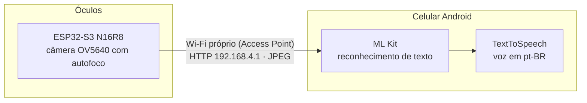

# Eye-cam

Leitor de texto assistivo: uma câmera com autofoco presa ao óculos
(ESP32-S3 + OV5640) fotografa a página, e um app Android reconhece o texto e o
lê em voz alta, em português. Tudo funciona **sem internet**: nenhuma página
lida sai do aparelho.



1. Toque duplo na tela do celular
2. O app pede uma foto em resolução baixa só para o autofoco convergir e, em
   seguida, a foto em alta resolução, sem refocar
3. Se o texto estiver pequeno na imagem, o app a amplia antes do OCR
4. O texto é lido em voz alta

O óculos é passivo: só captura quando o celular pede.

## Estrutura

```
├── app-android/                 projeto do Android Studio
└── firmware/eyecam_firmware/    sketch do Arduino para o ESP32-S3
```

---

## Firmware (ESP32-S3)

### Requisitos

| Item | Versão |
|---|---|
| Arduino IDE | 2.x |
| Pacote de placas **esp32** (Espressif) | 3.0 ou superior (testado: 3.3.11) |
| Biblioteca **OV5640 Auto Focus for ESP32 Camera** (Eric Nam) | mais recente |
| Placa | ESP32-S3 N16R8 (16 MB flash, 8 MB PSRAM Octal) + OV5640 AF |

Se o pacote esp32 não aparecer no Boards Manager, adicione em
**File → Preferences → Additional boards manager URLs**:
`https://espressif.github.io/arduino-esp32/package_esp32_index.json`

### Senha do Wi-Fi

A senha da rede do óculos **não fica no repositório**. Na pasta
`firmware/eyecam_firmware/`, copie `segredos.exemplo.h` para **`segredos.h`**
e troque a senha (8 a 63 caracteres). O `segredos.h` está no `.gitignore`.

O app Android lê a **mesma** senha desse arquivo ao compilar, para conectar
sozinho à rede do óculos. Ao trocar a senha, grave o firmware e recompile o
app. A senha fica dentro do APK: não distribua o APK compilado.

### Configuração da placa (menu Tools)

Ajuste **Flash Size antes de Partition Scheme**.

| Opção | Valor |
|---|---|
| Board | ESP32S3 Dev Module |
| Flash Size | 16MB (128Mb) |
| Partition Scheme | 16M Flash (3MB APP/9.9MB FATFS) |
| PSRAM | **OPI PSRAM** (com outro valor a câmera não inicia) |
| USB CDC On Boot | Enabled |
| USB Mode | Hardware CDC and JTAG |
| Upload Mode | UART0 / Hardware CDC |
| CPU Frequency | 240MHz (WiFi) |

Grave pela porta USB nativa (OTG) e abra o Serial Monitor a 115200. Se o
upload falhar com `Failed to connect`: segure **BOOT**, aperte e solte
**RESET**, solte **BOOT** e tente de novo.

### Rotas HTTP (todas GET, em `http://192.168.4.1`)

| Rota | Resposta |
|---|---|
| `/ping` | `OK` |
| `/capture` | Foto JPEG. `res=qvga\|vga\|svga\|xga\|sxga\|uxga\|qxga\|qsxga` (`5mp` = `qsxga`, 2560×1920); `af=0` captura sem focar. Cabeçalhos de medição `X-Eyecam-*` (foco, tempos de cada etapa, resolução real, avisos `FB-OVF`), também nas respostas de erro |
| `/focus` | Diagnóstico do autofoco |
| `/info` | JSON: sensor, autofoco, XCLK, resoluções, ajustes de imagem, memória, BSSID do Access Point, motivo do último reset |
| `/tune` | Ajusta e informa a imagem: `sharpness=-3..3`, `denoise=0..8`, `contrast=-2..2`, `quality=4..63` (0 = automática); `reset=1` reinicia a placa |
| `/log` | Últimas 64 mensagens do firmware, numeradas; `desde=N` devolve só as posteriores à N |

Rede: `EyeCam_01`, com a senha do `segredos.h`. O firmware aceita uma conexão
por vez.

---

## App Android

### Requisitos

Android Studio (Quail 2026.1.1 ou posterior) com o **Android SDK Platform 36**.
Celular com Android 8.0 ou superior.

### Compilar e instalar

1. Android Studio → **File → Open** → pasta **`app-android`** (não a raiz)
2. Aguarde o Gradle Sync
3. No celular, ative a **Depuração USB** (Opções do desenvolvedor) e conecte o cabo
4. Clique em **▶ Run**

Pelo terminal, dentro de `app-android` (o projeto usa Java 21; o JDK do
Android Studio serve):

```powershell
$env:JAVA_HOME = "C:\Program Files\Android\Android Studio\jbr"; .\gradlew.bat assembleDebug
```

O APK fica em `app-android/app/build/outputs/apk/debug/app-debug.apk`.

**Não atualize** `core-ktx`, `lifecycle` nem o Compose quando o Android Studio
sugerir: as versões novas exigem compileSdk 37 e quebram o build
(`checkDebugAarMetadata ... compile against version 37`). As versões corretas
estão em `app-android/gradle/libs.versions.toml`.

### Uso

1. Ligue o óculos e abra o app
2. Na **primeira** leitura, o Android pergunta se o app pode conectar à rede
   `EyeCam_01`: confirme. Daí em diante a conexão é automática, sem
   confirmação, e ao fechar o app o celular volta ao Wi-Fi de costume

A conexão automática exige Android 10 ou superior. No Android 8 e 9, conecte
o celular à rede `EyeCam_01` nas configurações de Wi-Fi (escolha **manter
conexão** quando o Android avisar que a rede não tem internet).

**Modo acessível** (tela inicial; a tela inteira é a área de toque):

| Gesto | Ação |
|---|---|
| Tocar duas vezes | Captura e lê |
| Deslizar para a direita | Repete a última leitura |
| Deslizar para a esquerda | Para a leitura |
| Tocar e segurar | Testa a conexão |

Com o **TalkBack**, o toque duplo dispara a leitura e "Repetir" e "Parar"
ficam no menu de ações.

**Modo desenvolvedor** (botão "Dev"): captura em SVGA a 5 MP, com ou sem
autofoco; abre imagens da galeria (para testar o OCR sem o óculos); liga e
desliga cada etapa de tratamento OpenCV; enquadramento automático; leitura
completa com ou sem portão de estabilidade; medições de tempo e tamanho;
cálculo de acerto contra o texto de referência; cópia do resultado;
diagnóstico e tempo da conexão; "Esquecer óculos" (para trocar de placa).

**Modo bancada** (dentro do modo desenvolvedor): planos de teste com as
condições já definidas (resolução, autofoco, leitura, repetições). Um botão
por teste: o app fotografa, lê o texto, calcula o acerto de cada corpo de
letra da página de teste e grava a foto original, um registro com todas as
medições e uma planilha CSV em `Download/EyeCam/<sessão>`.

### Testes

```powershell
$env:JAVA_HOME = "C:\Program Files\Android\Android Studio\jbr"; .\gradlew.bat testDebugUnitTest
```

Testes unitários de: estabilidade e métrica de acerto (`EstabilidadeTest`,
`MedidorAcertoTest`), divisão de textos longos para a voz
(`DivisaoTextoTest`), regra de ampliação (`AmpliacaoAdaptativaTest`), regras
da conexão automática (`RegrasConexaoTest`) e planos e registros do modo
bancada (`PlanoTestesTest`, `RegistroTestesTest`).

---

## Problemas comuns

| Sintoma | Solução |
|---|---|
| `ESP32_OV5640_AF.h: No such file` | Instalar a biblioteca de autofoco |
| `Falta segredos.h` | Copiar `segredos.exemplo.h` para `segredos.h` |
| `Camera init failed` | PSRAM em **OPI**; reencaixar o cabo da câmera com a placa desligada |
| Serial Monitor mudo | USB CDC On Boot = Enabled; 115200 baud |
| `requires ... compile against version 37` | Voltar às versões do `libs.versions.toml` |
| App diz "Óculos não encontrado" | Óculos desligado ou longe; no Android 8/9, celular fora da rede `EyeCam_01` |
| Conexão parou depois de trocar a placa | Modo desenvolvedor → **Esquecer óculos** (o endereço MAC mudou) |
| Android pede para conectar a cada leitura | Firmware anterior à v5.5 (não informa o BSSID em `/info`): gravar a v5.5 |
| App manda conectar à mão no Android 10+ | App compilado sem o `segredos.h`: criar o arquivo e recompilar |
| App lê, mas não fala | Instalar a voz em português (Brasil) nas configurações de texto para voz |

## Licença

[GPL-3.0](LICENSE). O portão de estabilidade (`Estabilidade.kt`) adapta
funções do [GameSentenceMiner](https://github.com/bpwhelan/GameSentenceMiner),
também GPL-3.0.
